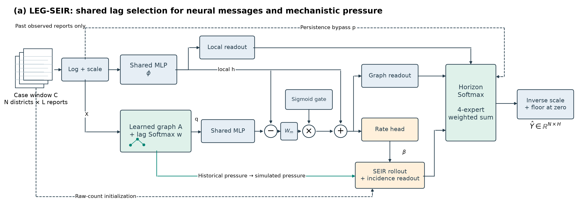

# LEG-SEIR

**Lagged Exposure for Graph-Based Dengue Forecasting**

A compact forecaster coupling historical lag selection to neural graph messages and SEIR-inspired imported pressure, with a historical-to-simulated pressure transition and horizon-specific mixing.

[Paper](paper/LEG_SEIR_manuscript.pdf) · [Supplement](paper/LEG_SEIR_supplement.pdf) · [Data and evidence](https://huggingface.co/datasets/rathishTharusha/leg-seir) · [Reproduce](docs/REPRODUCIBILITY.md) · [Method](docs/METHOD.md)

**Lecturer-review status:** the team-revised manuscript, author list, code and recorded evidence are available for review. See [review guide](REVIEW_GUIDE.md) and [function-level code guide](docs/CODE_GUIDE.md).

## Recorded result

| Method | 2026 RMSE, mean over five seeds |
|---|---:|
| Persistence | 87.382382 |
| Identity MLP | 81.392283 |
| Shared adapter | 80.756884 |
| LEG-SEIR | **79.634330** |

The same 18 overlapping forecast origins, 25 districts and three report horizons are used for every row. These are retrospective results from a previously inspected case study, not prospective confirmation or significance evidence. Several simple baselines already beat persistence. The proposed model's improvement over shared adapter is modest (1.39%).



## Quick start: inspect the recorded experiment on CPU

```sh
python -m pip install -r requirements-cpu.txt
python -m pip install -e . --no-deps
python scripts/fetch_artifacts.py
python scripts/verify.py artifacts/evaluation_outputs.zip artifacts/verified
python scripts/build_figures.py
python -m unittest discover -s tests -v
```

This verifies all 265 archived neural fits and regenerates figures. It does not train them again. Downloads are pinned to an immutable HF revision and SHA256 hashes.

## Train from scratch

Run [the standalone audited-input training notebook](notebooks/LEG_SEIR_train_from_audited_data.ipynb) in a fresh GPU environment. It downloads the input tables, uses the unchanged model/training cells and fits the complete development/final experiment. It never reads archived predictions or weights as training inputs. It has a new loader/code identity; the original paper's reported run is preserved unchanged under [experiments/frozen](experiments/frozen/).

The [original full-source notebook](experiments/frozen/Dengue_final_study.ipynb) starts from original report PDFs. Their URLs/hashes and strict retrieval instructions are public; third-party raw source archives are retained separately. See [data provenance and rights](docs/DATA.md).

## Repository map

- `src/leg_seir/`: readable scientific fragments and reusable model factory.
- `experiments/frozen/`: immutable original full-study notebook.
- `notebooks/`: standalone public-input training and saved-result gallery.
- `scripts/`: pinned retrieval, verification, source retrieval and figure generation.
- `results/`: compact scores, selection records, runtime and CPU verification.
- `figures/publication/`: nine publication figures and numerical inputs.
- `paper/`: team-revised seven-page IEEE manuscript and technical supplement (compiled PDFs only).
- `tests/`: scientific conservation, graph/mixing contracts and source identity.

The exact run contains 180 development + 75 primary final + 10 LR-sensitivity neural fits. Three ridge fits are separate. The archived verifier checks 915 file hashes, CPU checkpoint parity, reconstructed metrics, targets, scalers, chronology and development-only learning-rate selection.

## Limits and next experiments

No claim is made of first-ever graph-compartment coupling, biological identification, prospective generalization or superiority over external hybrid papers that were not rerun. Isolated lag/import/transition ablations, proxy-constant sensitivity, reporting-policy sensitivity and independent future/external evaluation remain open. The alternative printed-repeat series is not a completed LEG-SEIR robustness result. Negative results and competitive controls remain in the release.

## Licensing and citation

Original team code is MIT. Dataset/provider material has separate terms; MIT does not relicense the data or manuscript. Related papers are referenced by bibliography rather than redistributed as PDFs. Citation metadata follows the author list supplied in the revised manuscript. LaTeX sources and the Overleaf project are maintained separately by the team and are not distributed in the current repository. Venue-specific formatting remains to be confirmed.
